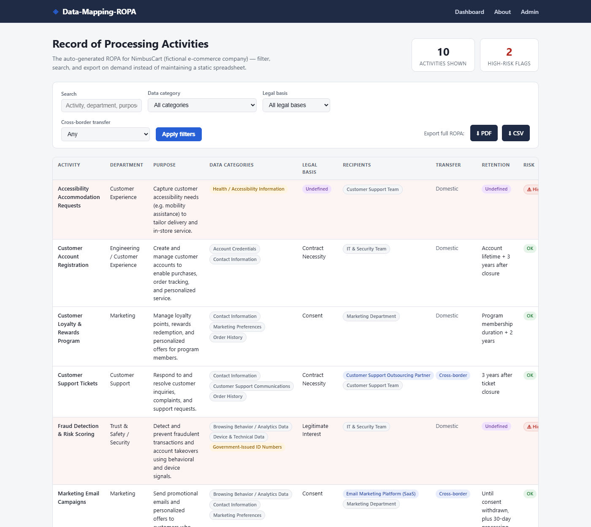

# Data-Mapping-ROPA

[](https://data-mapping-ropa.vercel.app)
[](https://github.com/GugaValenca)
[](https://www.linkedin.com/in/gugavalenca/)

A database-backed platform for maintaining a Record of Processing
Activities (ROPA) — the data map that GDPR Article 30 ("Records of
processing activities") and LGPD Article 37 (the equivalent obligation to
keep a record of personal data processing operations) require
organizations to keep current.<sup>[1]</sup> Processing activities are
entered once as structured, related records; the ROPA itself, its
filtered views, and its PDF/CSV exports are generated from that data on
demand, instead of being assembled by hand in a spreadsheet or Word
document that goes stale the moment it's saved.

<sub>[1] Verified against primary sources on October 2, 2026: GDPR Art. 30
at [eur-lex.europa.eu, Regulation (EU) 2016/679](https://eur-lex.europa.eu/legal-content/EN/TXT/?uri=celex%3A32016R0679)
(mirrored for readability at [gdpr-info.eu/art-30-gdpr](https://gdpr-info.eu/art-30-gdpr/));
LGPD Art. 37 at [planalto.gov.br, Lei 13.709/2018](https://www.planalto.gov.br/ccivil_03/_ato2015-2018/2018/lei/l13709.htm).
This citation is to the two articles' general subject matter only — it is
not a claim that this tool's output satisfies either article's specific
content requirements for a real organization.</sub>



## The problem it solves

Most ROPAs are static documents: built once for an audit, maintained
inconsistently afterward, and hard to query when someone actually needs
an answer — "which activities involve a cross-border transfer?", "which
ones rely on consent?", "which ones touch sensitive data without a
documented legal basis?". Answering those from a spreadsheet means
manually re-reading every row.

This system treats that data the way an application treats any other
structured record: normalized, filterable, and exportable in real time.
The result is a data map a privacy team can actually query and hand to
an auditor on demand, with high-risk gaps surfaced automatically instead
of found during a review.

## What it does

- **Relational data model** — processing activities link to reusable
  data categories, a legal basis, one or more recipients (internal teams
  or third parties, flagged individually for international/cross-border
  transfer), and a retention period with its business justification,
  instead of repeating free text across rows.
- **Admin-driven data entry** — record maintenance happens through
  Django's built-in admin (custom fieldsets, inline creation of related
  records, filters), so no bespoke CRUD UI was needed to keep the data
  current.
- **Filterable dashboard** — every activity at a glance, filterable by
  data category, legal basis, or cross-border transfer status, with free
  text search across name/department/purpose.
- **One-click export** — the current view (filtered or full) exports to
  a formatted PDF (ReportLab) or CSV, ready to hand to an auditor or
  regulator without reformatting anything.
- **Automated risk triage** — any activity that combines a sensitive
  data category with an undefined legal basis and/or retention period is
  flagged automatically. This is the difference between *recording* data
  processing and actually *assessing* it: the system surfaces exactly
  the kind of documentation gap a risk assessment needs to catch.

## Built with

- **Backend**: Django (models, admin, class-based query filtering, the
  ORM's `select_related`/`prefetch_related` used to keep the dashboard
  and exports to a handful of queries regardless of table size)
- **Frontend**: Django templates, plain CSS (light/dark aware), a few
  lines of vanilla JS — deliberately no frontend framework, to keep the
  UI layer as simple as the problem calls for
- **PDF generation**: [ReportLab](https://www.reportlab.com/) (pure
  Python — no native/GTK dependency, so the export pipeline runs
  unmodified on Windows, macOS, and Linux)
- **CSV export**: Python's standard-library `csv` module
- **Configuration**: `SECRET_KEY` / `DEBUG` / `ALLOWED_HOSTS` read from
  environment variables with dev-only fallbacks (`config/settings.py`,
  `.env.example`) — the codebase is deploy-ready without code changes
- **Deployment**: [Vercel](https://vercel.com) (Python/WSGI runtime),
  Postgres in production via `dj-database-url` (SQLite locally, no
  config needed), static files served by
  [WhiteNoise](https://whitenoise.readthedocs.io/) — see **Deployment**
  below

## Data privacy & compliance design

The data model mirrors the fields a ROPA is expected to carry: what data
is collected, why, on what legal basis, who it's shared with (flagging
international transfers separately, since GDPR and LGPD both attach
extra conditions to those), and how long it's retained and why. The
`is_high_risk` flag operationalizes a basic triage rule — sensitive data
category **and** (missing legal basis **or** missing retention period) —
directly in the model, so it's computed consistently everywhere the data
is displayed or exported rather than re-implemented per view.

**On the sample data**: the seeded processing activities belong to a
fictional company invented for this project. Legal-basis labels are
generic categories (Consent, Contract Necessity, Legitimate Interest,
Legal Obligation), not legal advice for any real situation, and
retention periods are illustrative placeholders — not asserted as
legally required durations. Anywhere a real deployment would need an
actual retention period or legal threshold sourced from statute, the
code carries a `# TODO: VERIFY legal retention standard against
official source` comment instead of a stated-as-fact number (see
`ropa/models.py` and `ropa/management/commands/seed_ropa.py`).

## Running it locally

```bash
# 1. Clone/enter the project directory, then create a virtual environment
python -m venv .venv
.venv\Scripts\activate        # Windows
# source .venv/bin/activate   # macOS/Linux

# 2. Install dependencies
pip install -r requirements.txt

# 3. Set up the database
python manage.py migrate

# 4. Load the sample ROPA data (10 fictional processing activities)
python manage.py seed_ropa

# 5. Create an admin login (choose your own username/password here —
#    there is no preset admin account in this repo)
python manage.py createsuperuser

# 6. Run the server
python manage.py runserver
```

By default the app runs with a development-only fallback secret key and
`DEBUG=True`, so the steps above work with zero configuration. To
override them (required before any real deployment — see **Security
notes** below), copy `.env.example` to `.env` and fill in real values,
or set `DJANGO_SECRET_KEY` / `DJANGO_DEBUG` / `DJANGO_ALLOWED_HOSTS` as
environment variables directly.

Then visit:

- **Dashboard**: <http://127.0.0.1:8000/>
- **Admin (data entry)**: <http://127.0.0.1:8000/admin/>
- **About**: <http://127.0.0.1:8000/about/>

Re-running `python manage.py seed_ropa` clears and reloads the sample
data (pass `--keep` to add to existing records instead).

## Testing

```bash
python manage.py test ropa
```

19 tests cover the parts most likely to break silently: the risk-triage
rule (every combination of sensitive/non-sensitive data with a missing
legal basis and/or retention period), the dashboard's filter and search
query logic exercised through the real endpoint, and both export
endpoints producing well-formed, filter-respecting CSV/PDF output.

## Project structure

```
api/index.py                   WSGI entrypoint Vercel's Python runtime routes into
vercel.json                     Vercel build/route config
config/                        Django project settings & root URLs
ropa/                           The ROPA app
  models.py                     DataCategory, LegalBasis, DataRecipient,
                                 RetentionPeriod, ProcessingActivity
  admin.py                      Django admin configuration
  views.py                      Dashboard, filters, about, export views
  exports.py                    CSV and PDF export logic
  tests.py                      Model, view-filter, and export tests
  management/commands/
    seed_ropa.py                 Fictional sample data for NimbusCart
  templates/ropa/                Dashboard, about, and base templates
static/                          CSS and JS
.env.example                     Environment variables this app reads (copy to .env)
```

## Security notes

- `SECRET_KEY`, `DEBUG`, and `ALLOWED_HOSTS` are read from environment
  variables (`DJANGO_SECRET_KEY`, `DJANGO_DEBUG`, `DJANGO_ALLOWED_HOSTS`)
  with dev-only fallbacks — see `config/settings.py` and `.env.example`.
  Never commit a real `.env` file (it's already git-ignored).
- There is no admin account bundled with this repo or its seed data —
  `createsuperuser` (step 5 above) is interactive and always asks you to
  set your own username/password.
- `db.sqlite3` is git-ignored. Sample/seed data lives in
  `ropa/management/commands/seed_ropa.py`, not in the database file, so
  nothing sensitive is at risk of being committed.
- Because `DJANGO_DEBUG=False` with no `DJANGO_SECRET_KEY` set would
  otherwise silently serve production traffic signed with the public,
  repo-visible dev-only key, `config/settings.py` refuses to start in
  that combination (raises `ImproperlyConfigured` instead).
- The CSV/PDF exports and admin login all accept requests from anonymous
  visitors, so each is rate-limited per visitor (`ropa/views.py`,
  `ropa/admin.py`) — 10/min for exports (PDF generation isn't free),
  5/min for admin login attempts. The limiter key trusts Vercel's
  `X-Real-IP` header only when actually running on Vercel
  (`RUNNING_ON_VERCEL`, `ropa/throttling.py`); elsewhere a client could
  set that header to anything, so `REMOTE_ADDR` is used instead.

## Deployment (Vercel)

The app is set up to deploy on Vercel's Python runtime — `vercel.json` +
`api/index.py` route every request into the Django WSGI app, and
`config/settings.py` switches from SQLite to Postgres automatically
whenever a `DATABASE_URL`/`POSTGRES_URL` is present, with no code
changes needed between the two. Vercel's serverless functions have no
persistent disk, which is the one thing that actually forces a change
from local dev: SQLite's on-disk file wouldn't survive between requests
there, so production needs a real Postgres database.

1. **Connect the repo**: in the Vercel dashboard, *Add New… → Project*,
   import `GugaValenca/Data-Mapping-ROPA` from GitHub.
2. **Add a Postgres database**: Project → *Storage* tab → *Create
   Database* → Postgres (this provisions a Neon-backed instance and
   injects `POSTGRES_URL` into the project's environment variables
   automatically — nothing to copy by hand).
3. **Set the remaining environment variables** (Project → *Settings →
   Environment Variables*):
   - `DJANGO_SECRET_KEY` — a freshly generated one (see `.env.example`
     for the one-liner that generates it)
   - `DJANGO_DEBUG` — `False`
   - `DJANGO_ALLOWED_HOSTS` — only needed for a custom domain; the
     `*.vercel.app` preview/production URL is trusted automatically
4. **Run migrations against the production database** (one-time, and
   again after any future model change — Vercel's build step doesn't run
   this for you):
   ```bash
   DATABASE_URL="<value from Vercel's Storage tab>" python manage.py migrate
   DATABASE_URL="<same value>" python manage.py createcachetable   # rate-limit counters
   DATABASE_URL="<same value>" python manage.py seed_ropa   # optional, sample data
   DATABASE_URL="<same value>" python manage.py createsuperuser
   ```
5. **Deploy**: `vercel --prod`, or push to the connected branch.

Verified locally end-to-end against a real Postgres 16 instance
(migrations, seed data, dashboard, filters, admin, and both exports)
before being written up here — not just against the code reading right.

## About the author

Gustavo Valença is a Brazilian-trained lawyer with legal team leadership
experience, working across Python/Django development and data privacy
law (LGPD, GDPR, CCPA). This project reflects that combination directly:
the data model encodes privacy-program concepts (legal bases, retention
justification, cross-border transfer flags, risk triage) as a
structured, tested Django application rather than as a static document.

[](https://github.com/GugaValenca)
[](https://www.linkedin.com/in/gugavalenca/)
